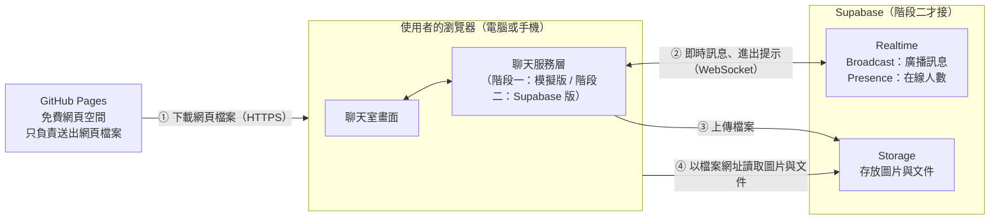
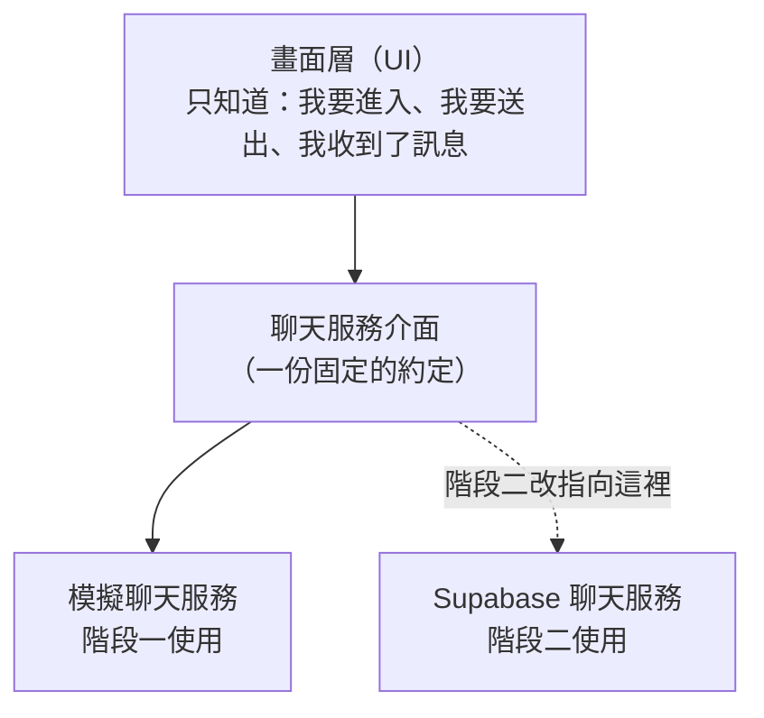
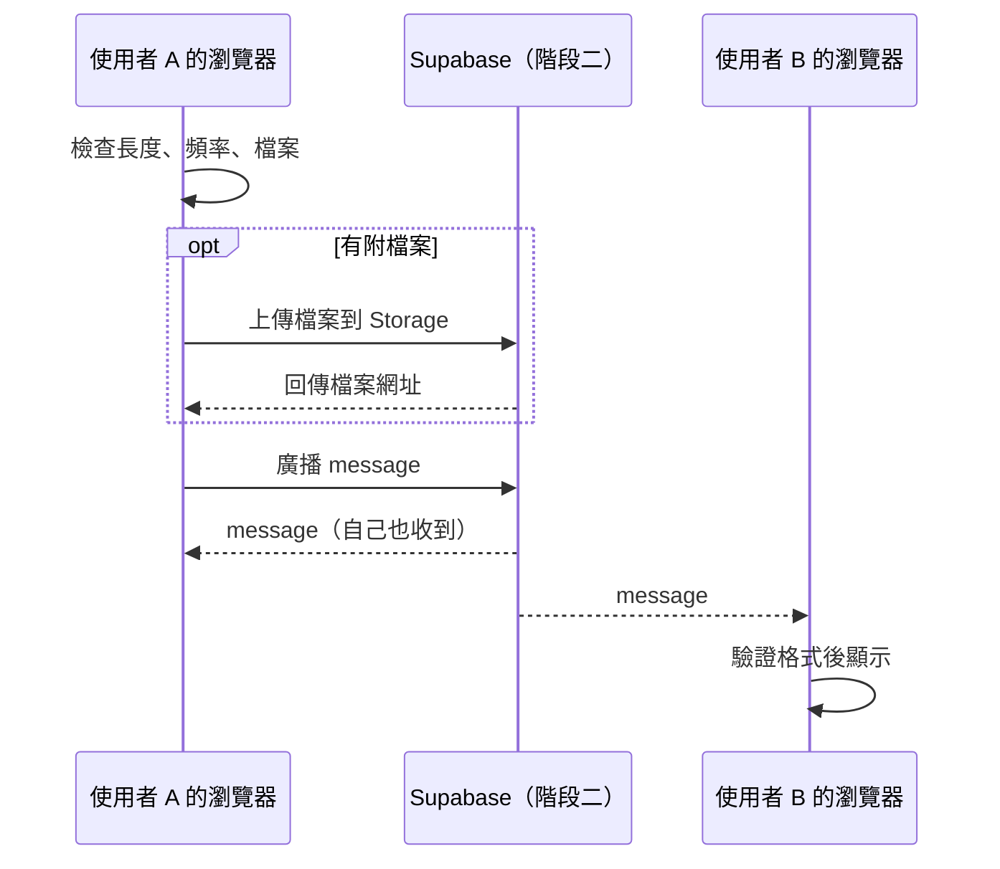

# 匿名聊天室：架構文件

> 這份文件寫給「不寫程式的人」。每個專有名詞第一次出現時，都會用一句話解釋。
> 需求來源：`docs/requirements.md` 與開發前的問答。
> 目前狀態：**階段一**（只有前端，尚未接上 Supabase）。

---

## 1. 專案說明與目標

**這是什麼**：一個不用登入的匿名聊天室。任何人拿到網址就能進來，輸入一個代號，和同時在線的所有人在同一個房間聊天。電腦和手機都能用。

**要達成的事**

- 打開網頁、輸入代號、馬上能聊，不需要註冊或登入。
- 可以傳文字，也可以傳圖片和常見文件（PDF、txt 等）。
- 看得到目前有多少人在線；有人進來或離開時有提示。
- 第一版重視「簡單、穩、免費」，不求功能多。

**已確認的使用者體驗（問答結果）**

| 項目 | 決定 |
|---|---|
| 歷史訊息 | 看不到。只看得到自己進來之後的新訊息 |
| 代號 | 1 到 20 個字，限中文、英文、數字；與目前在線的人重複就不能進入 |
| 文字訊息 | 最多 500 字 |
| 檔案 | 圖片與常見文件（PDF、txt），單檔最大 25MB |
| 在線資訊 | 只顯示在線**人數**，不顯示名單 |
| 進出提示 | 「有人進來了」「有人離開了」，不顯示名字 |
| 斷線 | 回到輸入代號的畫面，重新進入 |
| 防洗版 | 每人 10 秒內最多送 5 則，超過提示請稍等 |
| 訊息顯示 | 自己靠右、別人靠左；每則標示代號與時間 |
| 離開 | 有「離開」按鈕，回到輸入代號畫面 |
| 捲動 | 在最底下才自動捲；往上翻時顯示「有新訊息 ↓」 |
| 圖片 | 依畫面寬度直接顯示，不提供放大 |
| 進入畫面 | 放一段提醒：這是公開聊天室、離開後看不到先前內容 |

---

## 2. 整體架構圖

先認識三個角色：

- **瀏覽器**：使用者手上的 Chrome、Safari 等。聊天室的畫面和邏輯都在這裡跑。
- **GitHub Pages**：GitHub 提供的免費網頁空間，負責把網頁檔案（HTML、CSS、JavaScript）送到使用者的瀏覽器。它只送檔案，不處理聊天。
- **Supabase**：一個線上後端服務，負責「即時傳訊」和「存放檔案」。階段二才會接上。



**怎麼讀這張圖**

1. 使用者輸入網址，瀏覽器向 GitHub Pages 要網頁檔案，之後 GitHub Pages 就不再參與。
2. 聊天時，瀏覽器直接和 Supabase 建立一條長時間保持連線的通道（**WebSocket**：讓網頁和伺服器可以隨時互相傳話，不用一直重新整理）。
3. 傳檔案時，檔案先上傳到 Supabase 的 Storage，再把檔案網址當成訊息傳給大家。
4. 這個專案**沒有自己的伺服器**，也**沒有資料庫**：因為不保留歷史訊息，不需要存。

---

## 3. 技術選擇

### 3.1 前端：HTML + CSS + 原生 JavaScript，不用框架、不用打包工具

- **選了什麼**：用最基本的三件套寫網頁。
  - **HTML**：描述網頁上有哪些東西（輸入框、按鈕）。
  - **CSS**：描述它們長什麼樣子。
  - **JavaScript**：讓網頁會動、會回應操作。
  - **框架**（如 React、Vue）：一套幫忙組織大型網頁的工具，這次不用。
  - **打包工具**（如 Vite）：把程式碼轉換、壓縮後再發布的工具，這次也不用。
- **為什麼**
  1. 這個聊天室只有兩個畫面，用框架是殺雞用牛刀。
  2. 沒有打包工具，就沒有「安裝套件、編譯」這一整段流程，也不會出現「在我電腦能跑、在線上壞掉」的問題。寫好的檔案直接就能放上 GitHub Pages。
  3. 之後用 `/frontend-design` 產生畫面時，產出的就是這種直接可用的檔案。
- **代價**：如果日後功能長很大（多房間、登入），再考慮換框架。這份文件的分層設計（見第 4 節）會讓那時換起來不痛。

### 3.2 即時傳訊：Supabase Realtime 的 Broadcast 與 Presence

**Realtime** 是 Supabase 提供的即時通道服務，我們用其中兩個功能：

| 功能 | 一句話解釋 | 在這裡的用途 |
|---|---|---|
| **Broadcast** | 某人丟一則訊息，同一個頻道裡所有人立刻收到，**不存下來** | 傳送聊天訊息 |
| **Presence** | 每個連線的人都有一張「我在線上」的名牌，名牌增減會通知大家 | 在線人數、有人進來或離開的提示、代號是否重複 |

- **為什麼選這兩個，不用資料庫**：需求是「不保留歷史」，Broadcast 正好是「傳完就不存」。如果改用資料庫，反而要處理資料增長、清理、隱私等額外問題。
- **一個房間 = 一個頻道**，名稱固定為 `anonymous-chat-room`。

### 3.3 檔案：Supabase Storage

- **Storage** 是 Supabase 提供的檔案存放空間，像一個網路硬碟，每個檔案會得到一個網址。
- **為什麼**：Broadcast 不適合傳大檔案（單則訊息有大小上限），所以檔案放 Storage，訊息裡只帶網址。
- 使用一個名為 `chat-files` 的**公開 bucket**（bucket 就是 Storage 裡的「資料夾」；公開代表知道網址的人就能看）。
- 檔案用隨機名稱存放（例如 `a3f9…-c1.png`），別人猜不到網址。

### 3.4 不使用 Supabase 的哪些功能

- **Auth（登入系統）**：需求明確不要登入。
- **Database（資料庫）**：不保留歷史，不需要。
- 這也讓階段二的設定量很小。

### 3.5 驗證與發布

- **GitHub Actions**：GitHub 內建的自動化機器人，我們用它在每次更新後，自動把網站發布到 GitHub Pages。細節見第 12 節。

---

## 4. 兩個階段，以及如何不重寫

### 4.1 階段一：沒有 Supabase 的前端

**目標**：所有畫面與互動都做完、可以在 GitHub Pages 上點點看，只差真的跨裝置傳訊。

**能做到的**

- 完整的兩個畫面：輸入代號、聊天室。
- 代號格式檢查、文字長度檢查、檔案類型與大小檢查、10 秒 5 則的限制，都真的會作用。
- 送出文字、圖片、文件，自己的訊息會顯示在右側。
- 「有新訊息 ↓」、離開按鈕、人數顯示、各種錯誤提示。
- **用「模擬聊天服務」假裝有別人**：
  - 同一個瀏覽器開**兩個以上的分頁**，每個分頁就是一個不同的人，彼此可以互傳訊息。這是用瀏覽器內建的 `BroadcastChannel`（同一個瀏覽器內，分頁之間互相傳話的功能）做到的。
  - 另外提供「示範訪客」：網址加上 `?demo=1`，會有幾個機器人偶爾發言、進出，讓你一個人也能看到熱鬧的畫面和進出提示。

**做不到的（刻意如此）**

- 不同電腦、不同手機之間無法互傳。這要等階段二。
- 檔案不會真的上傳到網路，只在自己的瀏覽器內顯示。

**怎麼在 GitHub Pages 上看到**：見第 12 節。網址形如 `https://jonathankhu.github.io/anonymous-chat/`。

### 4.2 階段二：接上 Supabase

**改變的只有一個地方**：把「模擬聊天服務」換成「Supabase 聊天服務」。畫面程式碼不動。

**階段二要做的事**

1. 在 Supabase 建立專案、頻道設定、`chat-files` bucket 與規則。
2. 把網址與公開金鑰填進發布流程（第 8、12 節）。
3. 寫好「Supabase 聊天服務」，接上 Broadcast、Presence、Storage。
4. 設定舊檔清理（見第 9 節）。
5. 用兩台真實裝置驗證（第 13 節）。

### 4.3 讓前端「不用整個重寫」的設計

核心做法：**把畫面和「怎麼傳訊」切成兩層，中間用固定的約定溝通**。



三條規則：

1. **畫面層絕不直接碰 Supabase**。它只呼叫服務介面的幾個動作：`join`、`send`、`leave`，並接收幾種事件（第 5 節）。
2. **兩個服務長得完全一樣**：同樣的動作、同樣的事件、同樣的資料格式。換掉其中一個，畫面不會察覺。
3. **用一個設定值切換**：設定檔裡的 `backend` 是 `"mock"` 或 `"supabase"`。設定檔缺少時，一律當作 `"mock"`，所以階段一不需要任何金鑰。

另外，所有「檢查規則」（代號格式、長度、檔案類型、頻率）集中在同一個檔案，兩個服務與畫面共用，確保規則只有一份。

---

## 5. 通訊約定

這一節是「前端各部分之間、以及前端與 Supabase 之間的共同語言」。階段一與階段二都遵守。

### 5.1 服務介面：畫面可以叫服務做什麼

| 動作 | 說明 | 成功 / 失敗結果 |
|---|---|---|
| `join(nickname)` | 用這個代號進入聊天室 | 成功；或失敗，原因為 `INVALID_NICKNAME`（格式不對）、`NICKNAME_TAKEN`（已有人使用）、`CONNECTION_FAILED`（連不上） |
| `send({ text, file })` | 送出訊息，文字與檔案至少要有一個 | 成功；或失敗，原因為 `EMPTY`、`TOO_LONG`、`RATE_LIMITED`、`FILE_TOO_LARGE`、`FILE_TYPE_NOT_ALLOWED`、`UPLOAD_FAILED`、`NOT_JOINED` |
| `leave()` | 離開聊天室 | 無 |

### 5.2 服務事件：服務會通知畫面什麼

| 事件名稱 | 何時發生 | 帶的資料 |
|---|---|---|
| `message` | 收到一則聊天訊息（包含自己送的） | 訊息資料（5.3） |
| `online-count` | 在線人數改變 | `{ count: 整數 }` |
| `someone-joined` | 有別人進來 | 無資料（不含名字） |
| `someone-left` | 有別人離開 | 無資料（不含名字） |
| `connection-lost` | 連線中斷 | `{ reason: 文字 }` |

### 5.3 訊息資料格式

每則聊天訊息都是這個形狀：

```json
{
  "id": "訊息編號，隨機產生的唯一字串",
  "senderId": "傳送者的連線編號，隨機字串，用來判斷是不是自己",
  "nickname": "小明",
  "text": "大家好",
  "file": null,
  "sentAt": "2026-10-13T14:32:05.000Z"
}
```

有附檔案時，`file` 變成：

```json
{
  "url": "https://……/chat-files/a3f9-c1.png",
  "name": "旅行照片.png",
  "type": "image/png",
  "size": 482113
}
```

規則：

- `text` 可以是空字串（只傳檔案時），但 `text` 與 `file` **不可同時為空**。
- `text` 最多 500 字。`nickname` 為 1 到 20 個字（中文、英文、數字）。
- `file.type` 只能是允許清單內的值（見第 9 節）；`file.size` 最大 25MB（26,214,400 位元組）。
- `sentAt` 用標準時間格式，畫面顯示時轉成使用者本地的「時:分」。
- 一則訊息最多一個檔案。

### 5.4 Supabase 上的對應（階段二）

| 約定 | 在 Supabase 上怎麼做 |
|---|---|
| 房間 | 頻道名稱 `anonymous-chat-room` |
| `message` | Broadcast 事件，事件名 `message`，內容為 5.3 的資料；設定「自己也收得到」，讓自己與別人走同一條顯示路徑 |
| 在線人數、進出 | Presence。每個連線的名牌是 `{ senderId, nickname, joinedAt }`；人數＝名牌數 |
| 檔案 | Storage 的 `chat-files` bucket |

---

## 6. 資料流：每種情境發生什麼事

### 6.1 進入聊天室

1. 使用者開啟網頁，看到輸入代號畫面。
2. 輸入代號，畫面即時檢查格式（1 到 20 個字，限中文、英文、數字）；不合格就停用「進入」按鈕並說明原因。
3. 按下「進入」，畫面呼叫 `join(nickname)`。
4. 服務連上頻道，取得目前所有人的名牌。
5. **代號重複檢查**：忽略大小寫比較。若有別人的名牌用同樣代號 → 回報 `NICKNAME_TAKEN`，畫面留在輸入代號畫面並顯示「這個代號已有人使用，請換一個」。
6. 沒有重複 → 把自己的名牌放上去 → 切換到聊天室畫面。
7. 其他人收到 `someone-joined`，顯示「有人進來了」；所有人的人數更新。自己不會看到自己的進入提示。
8. 聊天室一開始是空的，顯示一行「還沒有人說話」。

> 兩個人同一瞬間用同一個代號進入，有可能同時通過第 5 步。處理方式：名牌放上去之後，再檢查一次；若發現有人用同代號而且「進入時間比自己早」（相同時以連線編號較小者為準），就自己退出並顯示「這個代號已有人使用」。
> 這是在沒有伺服器、沒有登入的前提下，能做到的最好處理。

### 6.2 送出訊息

1. 使用者輸入文字，或選擇一個檔案，按「送出」。
2. 畫面先檢查，不合格就直接提示、不送出：
   - 文字與檔案都沒有 → `EMPTY`
   - 文字超過 500 字 → `TOO_LONG`
   - 10 秒內已送 5 則 → `RATE_LIMITED`，提示「送太快了，請稍等一下」
   - 檔案超過 25MB → `FILE_TOO_LARGE`，提示「檔案太大」
   - 檔案類型不在允許清單 → `FILE_TYPE_NOT_ALLOWED`
3. 有檔案：先上傳到 Storage，取得網址。上傳中，送出按鈕顯示「上傳中」。失敗就提示 `UPLOAD_FAILED`，**訊息不會送出**，輸入內容保留。
4. 組出 5.3 格式的訊息，廣播出去。
5. 每個人（包含自己）收到 `message` 事件，先**驗證格式**（見第 9 節），通過才顯示。
6. 顯示方式：自己的靠右，別人的靠左；標示代號與時間。
7. 若使用者正在底部，自動捲到最新；若正在往上翻，不動，並顯示「有新訊息 ↓」。



### 6.3 離開

**主動離開**

1. 使用者按「離開」。
2. 服務收回自己的名牌、關閉頻道。
3. 畫面清空聊天內容，回到輸入代號畫面。
4. 其他人收到 `someone-left`，顯示「有人離開了」。

**直接關掉分頁或瀏覽器**

- Supabase 偵測到連線斷了，會自動收回名牌，其他人同樣收到 `someone-left`。
- 這個偵測可能需要數秒到半分鐘，所以提示會稍微延遲，這是正常現象。

### 6.4 斷線與重新連線

依問答結果：**斷線後回到輸入代號畫面，由使用者重新進入。**

1. 畫面偵測到連線中斷（服務發出 `connection-lost`，或瀏覽器回報離線）。
2. 畫面清空聊天內容，回到輸入代號畫面，並在上方顯示「連線中斷，請重新進入」。
3. 使用者重新輸入代號、按「進入」，流程與 6.1 相同。
4. **一個細節**：伺服器可能還來不及移除「舊的自己」，導致用原本代號進入時被誤判為重複。處理方式：每個分頁在開啟時產生一個連線編號並暫存在該分頁（關掉分頁就消失）；若發現重複的名牌**就是自己這個分頁的編號**，視為同一個人，允許進入。
5. 其他人看到的是「有人離開了」，之後「有人進來了」。

---

## 7. 畫面清單

> 這一節只規定「有什麼元素、做什麼事」。顏色、字型、版面、動畫由 `/design` 與 `/frontend-design` 決定。
> 兩個畫面都必須在手機和電腦上可用。

### 畫面 A：輸入代號

| 元素 | 行為 |
|---|---|
| 標題（聊天室名稱） | 純顯示 |
| 提醒文字 | 固定一段話：「這是公開聊天室，任何人都看得到你的訊息與檔案；離開後你就看不到先前的內容。」 |
| 代號輸入框 | 即時檢查：1 到 20 個字，中文、英文、數字。不合格時顯示原因 |
| 錯誤訊息區 | 顯示「這個代號已有人使用，請換一個」、「連線失敗，請稍後再試」、「連線中斷，請重新進入」 |
| 「進入」按鈕 | 代號不合格時無法按。按下後顯示載入中，避免重複按。按 Enter 鍵等同按下 |

### 畫面 B：聊天室

| 元素 | 行為 |
|---|---|
| 頂部列：聊天室名稱 | 純顯示 |
| 頂部列：在線人數 | 顯示「目前 N 人在線」，即時更新，**不顯示名單** |
| 頂部列：「離開」按鈕 | 按下後回到畫面 A |
| 訊息區：聊天訊息 | 自己靠右、別人靠左；每則含代號與時間（時:分）；文字原樣顯示，不解析成連結或格式 |
| 訊息區：圖片訊息 | 依畫面寬度顯示，不提供放大；載入失敗時改顯示檔名 |
| 訊息區：文件訊息 | 顯示檔名與大小，點擊下載 |
| 訊息區：系統提示 | 置中顯示「有人進來了」「有人離開了」，與聊天訊息外觀有區別 |
| 訊息區：空狀態 | 還沒有任何訊息時，顯示「還沒有人說話」 |
| 「有新訊息 ↓」按鈕 | 使用者正在往上翻、又有新訊息時才出現。點了捲到最底並消失；自己手動捲到底也會消失 |
| 輸入框 | 多行文字。電腦上 Enter 送出、Shift+Enter 換行；手機上用「送出」按鈕 |
| 字數提示 | 接近上限時顯示剩餘字數；超過 500 字時無法送出 |
| 「附加檔案」按鈕 | 開啟系統檔案選擇器；選擇後在輸入框附近顯示檔名，可取消 |
| 「送出」按鈕 | 文字與檔案都沒有時無法按；上傳中顯示「上傳中」並暫停操作 |
| 提示訊息（toast，短暫浮現又消失的小訊息） | 用於：「送太快了，請稍等一下」、「檔案太大（上限 25MB）」、「不支援這種檔案」、「上傳失敗，請再試一次」 |

**畫面切換**

- A →（進入成功）→ B
- B →（按離開 / 斷線）→ A

---

## 8. 金鑰

**金鑰（key）**：一段長長的字串，像一把鑰匙，用來向服務證明「我有權限做這件事」。

### 8.1 這個專案會碰到的金鑰

| 名稱 | 是什麼 | 能公開嗎 | 前端會用嗎 |
|---|---|---|---|
| **Project URL** | 你的 Supabase 專案的網址 | 可以公開 | 會 |
| **anon key**（也叫 publishable key） | 「匿名訪客」的鑰匙。只能做 Supabase 規則允許匿名訪客做的事 | **可以公開**，設計上就是要放進網頁讓瀏覽器使用 | 會 |
| **service_role key**（也叫 secret key） | 「管理員」的鑰匙，**可以繞過所有權限規則**，能讀、改、刪全部資料與檔案 | **絕對不能公開** | **絕對不會** |
| 資料庫密碼 | 連資料庫用的密碼 | 絕對不能公開 | 不會（本專案不用資料庫） |
| GitHub 個人存取權杖（personal access token，GitHub 的另一種通行證） | 讓程式代替你操作 GitHub | 絕對不能公開 | 不會，本專案不需要 |

### 8.2 為什麼 anon key 可以公開

網頁在瀏覽器裡跑，任何人按右鍵「檢視原始碼」都能看到裡面的東西，所以**網頁裡放什麼，就等於公開什麼**。anon key 就是為這種情況設計的：它本身沒有特別權限，真正的保護來自 Supabase 端的規則（第 9 節）：

- 只允許匿名訪客上傳到 `chat-files`，而且限制檔案類型與大小。
- 不允許匿名訪客刪除或修改任何檔案。

### 8.3 怎麼取得

1. 登入 Supabase 網站，建立專案。
2. 進入專案的 **Project Settings → API**（設定 → API）。
3. 會看到 Project URL、anon / publishable key、service_role / secret key。
4. 只複製 **Project URL** 和 **anon key**，其餘不要碰。

### 8.4 放在哪裡

| 位置 | 放什麼 | 說明 |
|---|---|---|
| GitHub 儲存庫的 **Variables**（Settings → Secrets and variables → Actions → Variables） | `SUPABASE_URL`、`SUPABASE_ANON_KEY` | 這兩個本來就是公開資訊，所以用 Variables 即可 |
| 發布時自動產生的 `site/js/config.js` | 同上兩個值 | 由發布流程在 GitHub 上產生，不進入程式碼歷史 |
| 你自己電腦的 `site/js/config.js` | 同上兩個值 | 本機測試階段二時才需要；已被 `.gitignore` 排除 |
| 儲存庫內的 `site/js/config.example.js` | 假的範例值 | 這個**可以** commit，用來告訴人格式長什麼樣子 |
| Supabase 自己的 Secrets（Edge Function 設定處） | service_role key | 只在 Supabase 內部使用，清理檔案的排程用；見第 9 節 |

**service_role key 的放置原則**：不放在儲存庫、不放在 GitHub 上、不放在聊天或截圖裡。需要它的工作（清理舊檔）直接在 Supabase 內部執行，用它內建的環境變數，我們完全不需要複製出來。

### 8.5 怎麼避免被 commit 到 GitHub

1. **`.gitignore` 排除金鑰檔案**（**commit** 指把修改記錄進 git；**`.gitignore`** 是一份清單，列在裡面的檔案 git 會視而不見）。清單包含：
   - `site/js/config.js`
   - `.env`、`.env.*`（`.env.example` 除外）
   - `*.key`、`*.pem`
   - `service_role*`
2. **`CLAUDE.md` 明文禁止**：任何金鑰檔案不可 commit。
3. **只有 `config.example.js` 進版本控制**，且只含假值。
4. **commit 前自己快速檢查**：`git status` 看一眼，有沒有不認識的檔案。
5. **萬一不小心 push 了**：不要只是刪檔案（歷史裡還在）。要立刻到 Supabase 重新產生該金鑰（舊的作廢），再處理儲存庫。因為 anon key 本來就公開，真正致命的只有 service_role key。

---

## 9. 安全與限制

### 9.1 別人可能送什麼奇怪的東西進來，前端怎麼擋

不要信任任何從網路收到的資料，連「自己人」送的也一樣。因為任何人都能直接對頻道送資料，不一定透過我們的網頁。

| 可能的狀況 | 風險 | 處理 |
|---|---|---|
| 訊息文字裡夾帶程式碼，例如 `<script>…</script>` 或 `` | 被稱為 **XSS（跨站腳本攻擊）**：惡意文字在別人的瀏覽器裡被當成程式執行 | 所有文字一律以「純文字」方式放進畫面（`textContent`），**絕不使用** `innerHTML`。代號、檔名、訊息都適用 |
| 訊息欄位缺漏、型別錯誤、多出奇怪欄位 | 程式出錯、畫面壞掉 | 收到時逐欄驗證：型別、長度、必要欄位。不合格的整則丟棄，不顯示、不報錯 |
| 超長文字（遠超過 500 字） | 洗版、卡畫面 | 收到時再次檢查長度，超過就丟棄 |
| 代號含空白、特殊符號、超長，或偽造成「系統」 | 冒充、版面被撐壞 | 收到時用同一份代號規則檢查；不符就丟棄 |
| 檔案網址指向別的網站 | 追蹤使用者、載入惡意內容 | 收到時檢查網址必須屬於我們自己的 Supabase 專案 `chat-files`；否則當成無檔案處理或整則丟棄 |
| 檔案類型偽裝（把可執行檔改名成 .png） | 使用者下載後中招 | 只允許清單內的類型（見下）；圖片以 `` 顯示（瀏覽器不會把圖片當程式執行）；文件只提供下載連結，不在頁面內開啟 |
| SVG 圖片 | SVG 可內嵌腳本 | **不允許 SVG**，只收 jpg、png、gif、webp |
| 短時間大量送訊息 | 洗版、耗用免費額度 | 自己端限制 10 秒 5 則。接收端也會對同一個傳送者做同樣的計數，超過的丟棄 |
| 偽造 `senderId`、冒用別人的代號 | 冒充 | 無法完全避免（沒有登入）。這是「匿名、無登入」設計的已知取捨，見 9.3 |

**允許的檔案類型**

- 圖片：`image/jpeg`、`image/png`、`image/gif`、`image/webp`
- 文件：`application/pdf`、`text/plain`

> 單一檔案上限 25MB。這個上限在前端檢查，也會在 Supabase 的 `chat-files` bucket 設定一次（雙重把關）。同樣的，允許類型清單在前端與 bucket 都設一份。

### 9.2 Supabase 端的規則（階段二設定）

- `chat-files` bucket：公開讀取；匿名訪客只能**新增**，不能修改、不能刪除。
- bucket 層級限制單檔 25MB 與允許的檔案類型。
- 頻道使用公開頻道，不需要登入。

### 9.3 這個設計下無法避免的事（要有心理準備）

- **代號沒有擔保**：任何人在別人離開後，都可以用同一個代號。代號只是「現在這一刻的稱呼」。
- **沒有管理員、沒有封鎖、沒有舉報**：有人惡意洗版或傳不當檔案，只能靠頻率限制減輕，無法把人踢出去。
- **公開 bucket 的檔案，知道網址的人就能看**：即使離開聊天室，檔案仍然在伺服器上，直到被清理。
- **檔案不會自己消失**：Supabase 不會自動刪檔。需要清理機制（見 9.4）。

### 9.4 免費方案的限制（需要注意）

> 以下數字是撰寫文件時的大致值，Supabase 可能調整。**階段二動工前，請到 Supabase 官方的 Pricing（價格）頁面核對一次。**

| 項目 | 免費方案大致上限 | 對這個專案的影響 |
|---|---|---|
| 同時連線數（Realtime） | 約 200 | 同時在線超過約 200 人，後面的人連不上 |
| 每秒訊息數（Realtime） | 約 100 則 | 人很多又很活躍時可能被限流 |
| 每月 Realtime 訊息總量 | 約數百萬則 | 長期人多時可能用完 |
| Storage 總空間 | 約 1GB | **這是最容易先碰到的**：每個檔案最大 25MB，約 40 個大檔就滿了 |
| 單檔大小上限 | 約 50MB | 我們設 25MB，低於此限 |
| 每月流量（下載） | 約數 GB | 大圖被許多人載入會消耗得很快 |
| **專案閒置暫停** | 約 7 天沒有任何活動就會被暫停 | 暫停後聊天室打不開，要到 Supabase 網站手動按「恢復」 |

**因應方式**

1. **清理舊檔案**：階段二加入一個自動清理工作，定期把超過 24 小時的檔案刪除。因為沒有歷史訊息，超過一天的檔案本來就沒有人會再看到。這個工作在 Supabase 內部執行，用 service_role key 的權限，但金鑰不離開 Supabase（見 8.4）。
2. **如果清理工作還沒做好**：至少每週到 Supabase 後台手動清空 `chat-files`，並留意用量。
3. **用量警告**：Supabase 後台的 Usage 頁面可看到各項用量，階段二上線後建議每週看一次。
4. **GitHub Pages 本身**：免費方案有流量與容量上限，但對這種小網站遠遠足夠，不需要擔心。

---

## 10. 這一版刻意不做的事

| 不做的事 | 為什麼 |
|---|---|
| 註冊、登入 | 需求明確不要；也因此無法確認「誰是誰」 |
| 保留歷史訊息、新進者看舊訊息 | 問答已決定。省下資料庫與清理問題，也更貼近匿名的精神 |
| 顯示在線名單 | 問答已決定，只顯示人數 |
| 進出提示顯示名字 | 問答已決定，與不顯示名單一致 |
| 斷線後自動重連 | 問答已決定：回到輸入代號畫面，由使用者重新進入 |
| 圖片放大檢視 | 問答已決定，直接依畫面寬度顯示 |
| 訊息中的網址變成可點擊連結 | 公開環境下容易被拿去放惡意網址；第一版全部當純文字 |
| 多個聊天室 | 需求是「所有人在同一個聊天室」 |
| 私訊、@某人、回覆某則訊息 | 超出需求；也需要「識別某人」的能力，而匿名設計不提供 |
| 編輯、刪除已送出的訊息 | 沒有登入就無法判斷誰有權刪除，且 Broadcast 傳出就收不回 |
| 封鎖、舉報、管理員功能 | 沒有身份就沒有對象可封鎖；第一版以頻率限制減輕 |
| 新訊息提示音、瀏覽器通知 | 需要額外權限，也容易打擾；第一版不做 |
| 「正在輸入…」、已讀 | 增加大量即時事件，消耗免費額度，價值有限 |
| 多國語言 | 第一版只有中文（繁體） |
| 其他檔案類型（影片、壓縮檔、可執行檔等） | 風險高、空間消耗大 |

---

## 11. repo 資料夾結構

**repo**（repository，儲存庫）：存放這個專案所有檔案與修改歷史的地方，在 GitHub 上就是你的專案頁面。

```
anonymous-chat/
├── CLAUDE.md                      給 Claude 看的工作守則（專案說明、目前階段、禁止事項）
├── README.md                      專案簡介
├── .gitignore                     不讓 git 追蹤的檔案清單（含金鑰檔案）
│
├── docs/
│   ├── requirements.md            需求說明
│   └── architecture.md            本文件
│
├── site/                          要發布到 GitHub Pages 的網站，整個資料夾就是網站
│   ├── index.html                 網頁入口，內含兩個畫面
│   ├── css/
│   │   └── styles.css             外觀（由 /design 與 /frontend-design 決定）
│   ├── js/
│   │   ├── main.js                程式入口：決定用模擬版還是 Supabase 版
│   │   ├── ui.js                  畫面層：畫面切換、顯示訊息、處理按鈕
│   │   ├── rules.js               共用規則：代號格式、長度、檔案類型、頻率
│   │   ├── chat-service.js        聊天服務介面的約定（事件名稱、資料格式）
│   │   ├── mock-chat-service.js   階段一：模擬聊天服務
│   │   ├── supabase-chat-service.js  階段二：Supabase 聊天服務
│   │   ├── config.example.js      設定範例（假值，可 commit）
│   │   └── config.js              真實設定（被 .gitignore 排除；發布時自動產生）
│   └── assets/                    圖示等靜態資源
│
├── supabase/                      階段二才會用到
│   ├── setup-notes.md             在 Supabase 後台要點哪些設定的逐步說明
│   ├── storage-policies.sql       Storage 的規則（誰可以新增、讀取）
│   └── functions/
│       └── cleanup-files/         定期清理舊檔案的工作（在 Supabase 內執行）
│
└── .github/
    └── workflows/
        └── deploy.yml             自動發布到 GitHub Pages 的流程
```

**為什麼網站放在 `site/` 而不是根目錄**：根目錄還有文件、設定檔、Supabase 設定，這些不應該被發布。把要發布的內容關在 `site/` 裡，發布時只拿這個資料夾，不會誤傳別的東西。

---

## 12. 部署到 GitHub Pages

### 12.1 做法

使用 **GitHub Actions** 發布（而不是直接指定某個資料夾），原因：

1. 可以在發布時才把金鑰設定寫進 `config.js`，不需要把它放進程式碼歷史。
2. 發布範圍明確只有 `site/`。
3. 階段一與階段二用同一套流程，只差有沒有填金鑰。

### 12.2 一次性設定（你要自己在 GitHub 網站上點的）

1. 到 GitHub 儲存庫 → **Settings → Pages**。
2. **Source（來源）** 選 **GitHub Actions**。
3. 階段二時，再到 **Settings → Secrets and variables → Actions → Variables** 新增兩個 Variables：`SUPABASE_URL`、`SUPABASE_ANON_KEY`。階段一**不需要**。

### 12.3 每次發布會發生什麼

1. 你（或 Claude）把修改 push 到 `main` 分支。
2. GitHub Actions 自動啟動 `deploy.yml`：
   - 若有 `SUPABASE_URL` 與 `SUPABASE_ANON_KEY`，就產生 `site/js/config.js`，內容 `backend: "supabase"` 加上這兩個值。
   - 若沒有，就不產生（程式會自動退回 `"mock"` 模擬版）。
   - 把 `site/` 資料夾打包上傳到 GitHub Pages。
3. 約一兩分鐘後，網站更新完成。

### 12.4 網址

`https://jonathankhu.github.io/anonymous-chat/`

> **注意**：網址裡的專案名稱是子路徑，所以網頁裡所有檔案引用都必須用**相對路徑**（例如 `./js/main.js`），不能用以 `/` 開頭的路徑，否則在 GitHub Pages 上會找不到檔案。

### 12.5 手機測試

直接在手機瀏覽器開上述網址即可，不需要安裝任何東西。

---

## 13. 驗證清單

### 階段一：完成標準（模擬版，不需要 Supabase）

**進入**

- [ ] 在電腦與手機上都能打開 GitHub Pages 網址，看到輸入代號畫面
- [ ] 畫面上看得到提醒文字
- [ ] 空白代號、超過 20 字、含空白或符號的代號，都無法進入並顯示原因
- [ ] 1 到 20 字的中文、英文、數字代號可以進入
- [ ] 開兩個分頁，用同樣的代號（包含只差大小寫），第二個被擋下並顯示「已有人使用」
- [ ] 換一個代號後可以進入

**聊天**

- [ ] 送出文字後，自己的訊息靠右，含代號與時間
- [ ] 另一個分頁看到同一則訊息靠左
- [ ] 500 字可以送出；501 字無法送出，且有字數提示
- [ ] 空訊息無法送出
- [ ] 10 秒內送第 6 則時，出現「送太快了」提示且沒有送出
- [ ] 訊息裡輸入 `<b>粗體</b>` 與 `<script>alert(1)</script>`，畫面上原樣顯示為文字，沒有被執行
- [ ] 網址（如 `https://example.com`）顯示為文字，不能點

**檔案**

- [ ] 可以選擇並送出 jpg、png、gif、webp，圖片直接顯示、寬度不超出畫面
- [ ] 可以送出 PDF、txt，顯示檔名與大小並可點擊下載
- [ ] 超過 25MB 的檔案被擋下並提示
- [ ] 不允許的類型（如 .exe、.svg、.zip）被擋下並提示

**在線與進出**

- [ ] 在線人數正確，一個分頁進入或離開時，另一個分頁的人數即時更新
- [ ] 另一個分頁看到「有人進來了」「有人離開了」，**沒有名字**
- [ ] 自己進入時，不會看到自己的進入提示
- [ ] 網址加 `?demo=1` 時，出現示範訪客，並有進出提示與發言

**離開與捲動**

- [ ] 按「離開」回到輸入代號畫面，且聊天內容已清空
- [ ] 離開後原本的代號立刻可以被另一個分頁使用
- [ ] 訊息很多時，停在最底部會自動捲到最新
- [ ] 往上翻時來新訊息，畫面不動並出現「有新訊息 ↓」，點了回到底部
- [ ] 沒有任何訊息時，顯示「還沒有人說話」

**版面**

- [ ] 手機寬度（約 375px）下兩個畫面都完整可用，沒有橫向捲軸
- [ ] 電腦寬度下兩個畫面都完整可用
- [ ] 瀏覽器的主控台（開發者工具裡看錯誤訊息的地方）沒有紅色錯誤

**安全**

- [ ] 儲存庫裡沒有任何金鑰（階段一本來就沒有）
- [ ] `git status` 顯示 `config.js` 不會被追蹤（建立一個假的測試）

### 階段二：完成標準（接上 Supabase）

**金鑰與設定**

- [ ] 儲存庫 Variables 只放了 `SUPABASE_URL` 與 `SUPABASE_ANON_KEY`
- [ ] 整個儲存庫（含歷史）搜尋不到 service_role key
- [ ] 網頁原始碼裡只出現 anon key，沒有出現 service_role key
- [ ] 發布後網站不再是模擬版（用兩台不同裝置驗證）

**跨裝置**

- [ ] 電腦與手機（不同網路更好）進入同一個聊天室，互相看得到訊息
- [ ] 在線人數在兩邊一致
- [ ] 一邊進入或離開，另一邊看到對應提示（沒有名字）
- [ ] 直接關掉分頁，另一邊在約半分鐘內看到「有人離開了」，人數更新

**代號**

- [ ] 兩台裝置用同一個代號，後進入的被擋下
- [ ] 兩人同一瞬間用同代號進入，最後只剩一人留下（另一個被退出並提示）
- [ ] 一方離開後，原代號可以立刻被使用

**檔案**

- [ ] 一台裝置傳圖片，另一台正確顯示
- [ ] 一台裝置傳 PDF，另一台可以下載
- [ ] 25MB 以內的檔案成功；超過的被前端擋下
- [ ] 直接對 Supabase 嘗試上傳不允許的類型或超過 25MB 的檔案，被 Supabase 拒絕（雙重把關有效）
- [ ] 匿名訪客無法刪除或覆蓋 `chat-files` 裡的既有檔案

**斷線**

- [ ] 手機開飛航模式再關掉，回到輸入代號畫面並顯示「連線中斷」
- [ ] 用原代號重新進入成功，不會被誤判為「已有人使用」

**限制與清理**

- [ ] 清理工作可以執行，並把超過 24 小時的檔案刪除（可先用較短時限測試）
- [ ] 已核對 Supabase 官方 Pricing 頁面的免費額度，並更新第 9.4 節的數字
- [ ] Supabase 後台 Usage 頁面可以看到用量，並知道專案閒置暫停時該怎麼恢復

**一般**

- [ ] 階段一的所有驗證項目重新跑一遍仍然通過（確認換掉服務層沒有弄壞畫面）
