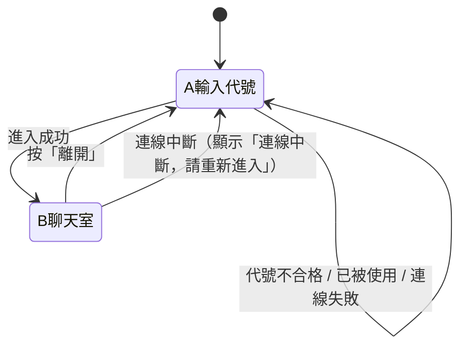

# 設計說明（給前端實作用）

> 來源：開發前的問答與 `docs/architecture.md` 第 4、5、7 節。
> 本文件只整理「畫面與互動」。技術細節、金鑰、部署請看 `architecture.md`。
> 視覺風格為 **Soft Pastel V2**，見第 8 節。

## 1. 設計原則

- 手機優先，同時在電腦上可用；兩個畫面在 375px 寬度不得出現橫向捲軸。
- 只有兩個畫面：**A 輸入代號**、**B 聊天室**。
- 所有訊息、代號、檔名一律當純文字顯示，不解析成 HTML 或連結。
- 畫面層不直接碰 Supabase，只透過聊天服務介面（見 `architecture.md` 4.3、5）。

## 2. 畫面流程

## 3. 畫面 A：輸入代號

| 元素 | 內容與行為 |
|---|---|
| 標題 | 聊天室名稱 |
| 提醒文字 | 「這是公開聊天室，任何人都看得到你的訊息與檔案；離開後你就看不到先前的內容。」 |
| 代號輸入框 | 1 到 20 個字，限中文、英文、數字。即時檢查，不合格時顯示原因 |
| 錯誤訊息區 | 「這個代號已有人使用，請換一個」／「連線失敗，請稍後再試」／「連線中斷，請重新進入」 |
| 「進入」按鈕 | 代號不合格時不能按；按下後顯示載入中、避免重複按；Enter 鍵等同按下 |

## 4. 畫面 B：聊天室

| 元素 | 內容與行為 |
|---|---|
| 頂部：名稱 | 聊天室名稱 |
| 頂部：在線人數 | 「目前 N 人在線」，即時更新，**不顯示名單** |
| 頂部：「離開」按鈕 | 回到畫面 A，清空聊天內容 |
| 聊天訊息 | 自己靠右、別人靠左；每則含代號與時間（時:分） |
| 圖片訊息 | 依畫面寬度顯示，**不提供放大**；載入失敗時改顯示檔名 |
| 文件訊息 | 顯示檔名與大小，點擊下載（PDF、txt） |
| 系統提示 | 置中顯示「有人進來了」「有人離開了」（無名字），外觀與聊天訊息有區別；不顯示自己的進入提示 |
| 空狀態 | 沒有任何訊息時顯示「還沒有人說話」 |
| 「有新訊息 ↓」 | 只在使用者往上翻、又有新訊息時出現；點了捲到底並消失，手動捲到底也消失 |
| 輸入框 | 多行；電腦 Enter 送出、Shift+Enter 換行；手機用「送出」按鈕 |
| 字數提示 | 接近 500 字時顯示剩餘字數；超過時不能送出 |
| 「附加檔案」按鈕 | 開檔案選擇器；選後顯示檔名，可取消；一則訊息最多一個檔案 |
| 「送出」按鈕 | 文字與檔案都沒有時不能按；上傳中顯示「上傳中」並暫停操作 |
| 提示（toast） | 「送太快了，請稍等一下」／「檔案太大（上限 25MB）」／「不支援這種檔案」／「上傳失敗，請再試一次」 |

## 5. 捲動規則

- 使用者在最底部：新訊息進來時自動捲到最新。
- 使用者往上翻：不動，顯示「有新訊息 ↓」。
- 自己送出訊息時：一律捲到底。

## 6. 限制數值（畫面與檢查共用）

| 項目 | 值 |
|---|---|
| 代號 | 1 到 20 字；中文、英文、數字；比對重複時忽略大小寫 |
| 文字訊息 | 最多 500 字 |
| 檔案大小 | 單檔最多 25MB |
| 允許類型 | `image/jpeg`、`image/png`、`image/gif`、`image/webp`、`application/pdf`、`text/plain`（不允許 SVG） |
| 頻率 | 每人 10 秒內最多 5 則 |

## 7. 階段一的示範行為

- 同一瀏覽器開多個分頁，每個分頁是不同的人，可互傳訊息。
- 網址加 `?demo=1`：出現示範訪客，會偶爾發言與進出，方便單人檢視畫面。
- 沒有金鑰設定檔時，一律使用模擬服務。

## 8. 視覺風格：Soft Pastel V2

溫柔、簡約、現代、有質感。所有數值集中在 `site/css/styles.css` 的 `:root`，換風格只改那一區。

### 配色

| 用途 | 色票 |
|---|---|
| 背景（奶油白） | `#FAF7F2` |
| 我的氣泡、主要按鈕（鼠尾草綠） | `#A8C5B5` |
| 別人的氣泡、提醒區塊（淡粉） | `#F4DDE4` |
| 文字、標題（深灰綠） | `#40564C` |
| 綠色底上的文字 | `#2B3C34`（白字在鼠尾草綠上對比不足，故用更深的綠） |

深色模式（`prefers-color-scheme: dark`）保留，沿用同色系，改為深綠灰底。

### 版面（V2 與舊版的差異）

- **頂部**：不再是貼邊橫條，而是浮在畫面上的圓角卡片（28px）。左側為鼠尾草綠漸層圓角方塊聊天圖示，中間是標題與「目前 N 人在線」膠囊（含綠色在線點），右側是「離開」。
- **訊息**：每則由上到下為「代號 → 氣泡 → 時間」。時間是氣泡下方的小標籤，不再與代號並排。實作上 `.msg__meta` 設為 `display: contents`，用 `order` 重排，JS 產生的結構沒有改。
- **氣泡**：22px 圓角，自己（鼠尾草綠）與他人（淡粉）都帶淡細邊框；圖片有白色邊框與柔和陰影。
- **系統提示與空狀態**：置中的半透明小膠囊。
- **輸入區**：浮動圓角工具列（30px），與畫面邊緣、底部保留間距；內含附件圖示、無框輸入框、送出按鈕；focus 時整條工具列出現綠色光環。字數提示為空時不佔位。
- **進入畫面（暱稱頁）**：奶油白、鼠尾草綠、櫻花粉的柔和漸層背景；中央一張白色圓角卡片（32px），含聊天圖示徽章、「歡迎來到匿名聊天室」標題、一句簡短說明、粉色提醒區塊、膠囊形暱稱輸入框（placeholder 為範例「例如：小花、Mia88」，格式規則寫在標籤上）與鼠尾草綠漸層的「進入 →」按鈕。
  - 按鈕文字由 JS 設定為「進入」／「進入中…」，為了不改 JS，箭頭用 CSS `::after` 加上。
  - 手機鍵盤：viewport 加上 `interactive-widget=resizes-content`，畫面用 `min-height: 100dvh` 並可捲動；高度不足 560px（鍵盤彈出、橫放）時卡片改為靠上，避免標題被推出畫面。
- **聊天室背景**：粉、綠光暈漸層，兩側有留白。

### 形狀與質感

- 圓角層級：氣泡 22px（靠近發話者的一角 6px）→ 工具列／標題 28–30px → 卡片 32–36px；按鈕、輸入框、提示為膠囊形。
- 陰影用低飽和綠灰色；邊框為柔和細線。
- 標題區與輸入工具列為半透明加模糊（`backdrop-filter`）。
- 新增色票變數：`--me-line`、`--other-line`、`--time-bg`、`--online-bg`、`--notice-card-text`（含深色模式版本）。

### 互動與動畫

- 按鈕 hover 微上浮、按下回彈；附加檔案圖示 hover 輕微旋轉。
- 輸入框 hover 邊框變綠，focus 出現綠色柔光環。
- 訊息淡入加上滑，卡片、toast、「有新訊息 ↓」有進場動畫。
- 使用「減少動態效果」設定的人，動畫與過渡會被關閉。

### 響應式

- 手機：滿版，使用 safe-area 避開瀏海與手勢條；氣泡最寬 85%。
- 平板／電腦（≥ 640px）：氣泡最寬 70%。
- 電腦（≥ 860px）：聊天室為置中的圓角卡片（最寬 860px），四周留白。
- 已檢查寬度：375、390、500px 與 1200px，皆無橫向捲軸。

### 範圍

V2 只改 `index.html`（新增兩個純裝飾的圖示 ``）與 `styles.css`。所有元素 id 與 JS 用到的 class 都保留；JavaScript、Supabase 與安全規則都沒有改動。

## 9. 待決定

- 聊天室名稱與標題文字（目前為「匿名聊天室」）。
