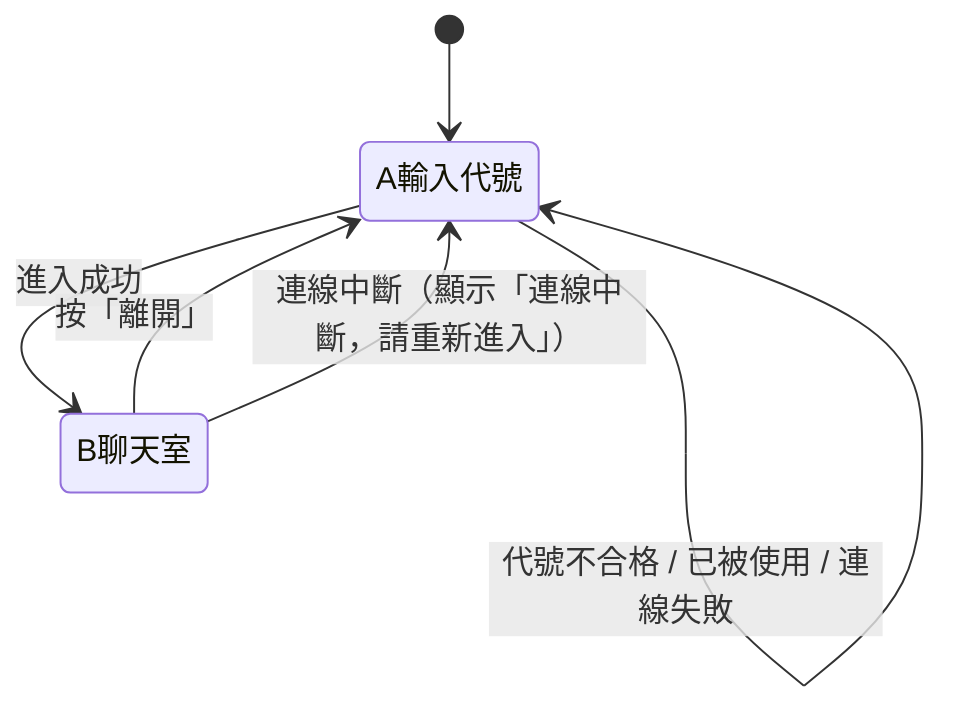

# 設計說明（給前端實作用）

> 來源：開發前的問答與 `docs/architecture.md` 第 4、5、7 節。
> 本文件只整理「畫面與互動」。技術細節、金鑰、部署請看 `architecture.md`。
> **視覺風格尚未決定**（顏色、字型、版面、動畫）。由 `/design` 與 `/frontend-design` 在做前端時決定，風格需求請使用者在那時提供。

## 1. 設計原則

- 手機優先，同時在電腦上可用；兩個畫面在 375px 寬度不得出現橫向捲軸。
- 只有兩個畫面：**A 輸入代號**、**B 聊天室**。
- 所有訊息、代號、檔名一律當純文字顯示，不解析成 HTML 或連結。
- 畫面層不直接碰 Supabase，只透過聊天服務介面（見 `architecture.md` 4.3、5）。

## 2. 畫面流程

## 3. 畫面 A：輸入代號

| 元素 | 內容與行為 |
|---|---|
| 標題 | 聊天室名稱 |
| 提醒文字 | 「這是公開聊天室，任何人都看得到你的訊息與檔案；離開後你就看不到先前的內容。」 |
| 代號輸入框 | 1 到 20 個字，限中文、英文、數字。即時檢查，不合格時顯示原因 |
| 錯誤訊息區 | 「這個代號已有人使用，請換一個」／「連線失敗，請稍後再試」／「連線中斷，請重新進入」 |
| 「進入」按鈕 | 代號不合格時不能按；按下後顯示載入中、避免重複按；Enter 鍵等同按下 |

## 4. 畫面 B：聊天室

| 元素 | 內容與行為 |
|---|---|
| 頂部：名稱 | 聊天室名稱 |
| 頂部：在線人數 | 「目前 N 人在線」，即時更新，**不顯示名單** |
| 頂部：「離開」按鈕 | 回到畫面 A，清空聊天內容 |
| 聊天訊息 | 自己靠右、別人靠左；每則含代號與時間（時:分） |
| 圖片訊息 | 依畫面寬度顯示，**不提供放大**；載入失敗時改顯示檔名 |
| 文件訊息 | 顯示檔名與大小，點擊下載（PDF、txt） |
| 系統提示 | 置中顯示「有人進來了」「有人離開了」（無名字），外觀與聊天訊息有區別；不顯示自己的進入提示 |
| 空狀態 | 沒有任何訊息時顯示「還沒有人說話」 |
| 「有新訊息 ↓」 | 只在使用者往上翻、又有新訊息時出現；點了捲到底並消失，手動捲到底也消失 |
| 輸入框 | 多行；電腦 Enter 送出、Shift+Enter 換行；手機用「送出」按鈕 |
| 字數提示 | 接近 500 字時顯示剩餘字數；超過時不能送出 |
| 「附加檔案」按鈕 | 開檔案選擇器；選後顯示檔名，可取消；一則訊息最多一個檔案 |
| 「送出」按鈕 | 文字與檔案都沒有時不能按；上傳中顯示「上傳中」並暫停操作 |
| 提示（toast） | 「送太快了，請稍等一下」／「檔案太大（上限 25MB）」／「不支援這種檔案」／「上傳失敗，請再試一次」 |

## 5. 捲動規則

- 使用者在最底部：新訊息進來時自動捲到最新。
- 使用者往上翻：不動，顯示「有新訊息 ↓」。
- 自己送出訊息時：一律捲到底。

## 6. 限制數值（畫面與檢查共用）

| 項目 | 值 |
|---|---|
| 代號 | 1 到 20 字；中文、英文、數字；比對重複時忽略大小寫 |
| 文字訊息 | 最多 500 字 |
| 檔案大小 | 單檔最多 25MB |
| 允許類型 | `image/jpeg`、`image/png`、`image/gif`、`image/webp`、`application/pdf`、`text/plain`（不允許 SVG） |
| 頻率 | 每人 10 秒內最多 5 則 |

## 7. 階段一的示範行為

- 同一瀏覽器開多個分頁，每個分頁是不同的人，可互傳訊息。
- 網址加 `?demo=1`：出現示範訪客，會偶爾發言與進出，方便單人檢視畫面。
- 沒有金鑰設定檔時，一律使用模擬服務。

## 8. 待決定

- 視覺風格（深色／淺色、字型、整體氣氛）：做前端前由使用者提供。
- 聊天室名稱與標題文字。
