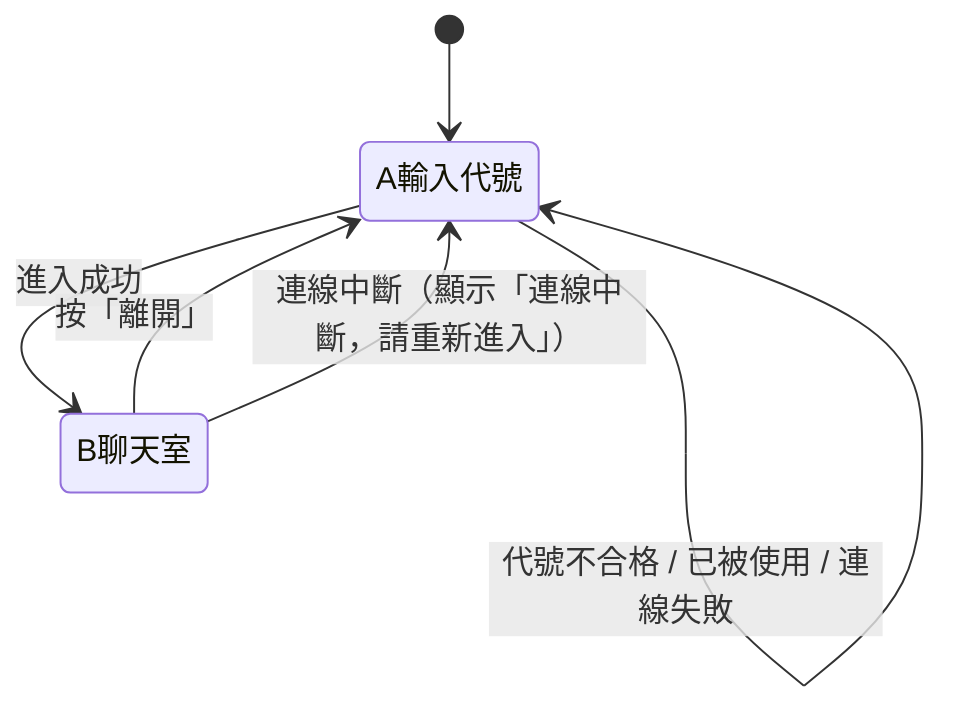

# 設計說明（給前端實作用）

> 來源：開發前的問答與 `docs/architecture.md` 第 4、5、7 節。
> 本文件只整理「畫面與互動」。技術細節、金鑰、部署請看 `architecture.md`。
> 視覺風格為 **Kawaii Pastel（V3）**，見第 8 節。

## 1. 設計原則

- 手機優先，同時在電腦上可用；兩個畫面在 375px 寬度不得出現橫向捲軸。
- 只有兩個畫面：**A 輸入代號**、**B 聊天室**。
- 所有訊息、代號、檔名一律當純文字顯示，不解析成 HTML 或連結。
- 畫面層不直接碰 Supabase，只透過聊天服務介面（見 `architecture.md` 4.3、5）。

## 2. 畫面流程

## 3. 畫面 A：輸入代號

| 元素 | 內容與行為 |
|---|---|
| 標題 | 聊天室名稱 |
| 提醒文字 | 「這是公開聊天室，任何人都看得到你的訊息與檔案；離開後你就看不到先前的內容。」 |
| 代號輸入框 | 1 到 20 個字，限中文、英文、數字。即時檢查，不合格時顯示原因 |
| 錯誤訊息區 | 「這個代號已有人使用，請換一個」／「連線失敗，請稍後再試」／「連線中斷，請重新進入」 |
| 「進入」按鈕 | 代號不合格時不能按；按下後顯示載入中、避免重複按；Enter 鍵等同按下 |

## 4. 畫面 B：聊天室

| 元素 | 內容與行為 |
|---|---|
| 頂部：名稱 | 聊天室名稱 |
| 頂部：在線人數 | 「目前 N 人在線」，即時更新，**不顯示名單** |
| 頂部：「離開」按鈕 | 回到畫面 A，清空聊天內容 |
| 聊天訊息 | 自己靠右、別人靠左；每則含代號與時間（時:分） |
| 圖片訊息 | 依畫面寬度顯示，**不提供放大**；載入失敗時改顯示檔名 |
| 文件訊息 | 顯示檔名與大小，點擊下載（PDF、txt） |
| 系統提示 | 置中顯示「有人進來了」「有人離開了」（無名字），外觀與聊天訊息有區別；不顯示自己的進入提示 |
| 空狀態 | 沒有任何訊息時顯示「還沒有人說話」 |
| 「有新訊息 ↓」 | 只在使用者往上翻、又有新訊息時出現；點了捲到底並消失，手動捲到底也消失 |
| 輸入框 | 多行；電腦 Enter 送出、Shift+Enter 換行；手機用「送出」按鈕 |
| 字數提示 | 接近 500 字時顯示剩餘字數；超過時不能送出 |
| 「附加檔案」按鈕 | 開檔案選擇器；選後顯示檔名，可取消；一則訊息最多一個檔案 |
| 「送出」按鈕 | 文字與檔案都沒有時不能按；上傳中顯示「上傳中」並暫停操作 |
| 提示（toast） | 「送太快了，請稍等一下」／「檔案太大（上限 25MB）」／「不支援這種檔案」／「上傳失敗，請再試一次」 |

## 5. 捲動規則

- 使用者在最底部：新訊息進來時自動捲到最新。
- 使用者往上翻：不動，顯示「有新訊息 ↓」。
- 自己送出訊息時：一律捲到底。

## 6. 限制數值（畫面與檢查共用）

| 項目 | 值 |
|---|---|
| 代號 | 1 到 20 字；中文、英文、數字；比對重複時忽略大小寫 |
| 文字訊息 | 最多 500 字 |
| 檔案大小 | 單檔最多 25MB |
| 允許類型 | `image/jpeg`、`image/png`、`image/gif`、`image/webp`、`application/pdf`、`text/plain`（不允許 SVG） |
| 頻率 | 每人 10 秒內最多 5 則 |

## 7. 階段一的示範行為

- 同一瀏覽器開多個分頁，每個分頁是不同的人，可互傳訊息。
- 網址加 `?demo=1`：出現示範訪客，會偶爾發言與進出，方便單人檢視畫面。
- 沒有金鑰設定檔時，一律使用模擬服務。

## 8. 視覺風格：Kawaii Pastel（V3）

可愛、溫馨的柔和粉彩風，靈感來自兔子與貓咪插畫。所有數值集中在 `site/css/styles.css` 的 `:root`，換風格只改那一區。

### 配色

| 用途 | 色票 |
|---|---|
| 背景（奶油白） | `#FAF7F2` |
| 我的氣泡、主要按鈕（鼠尾草綠） | `#A8C5B5` |
| 別人的氣泡、提醒區塊（腮紅粉） | `#F4DDE4` |
| 卡片邊框（暖奶油） | `#EFE6D9`（`--card-edge`） |
| 貓咪毛色（蜜桃） | `#FBE6D6`（`--peach`） |
| 文字、標題（深灰綠） | `#40564C` |
| 綠色底上的文字 | `#2B3C34`（白字在鼠尾草綠上對比不足） |

深色模式（`prefers-color-scheme: dark`）保留，沿用同色系。

### 插畫素材（`site/img/`，皆為手繪風 SVG，純裝飾、`alt=""`）

| 檔案 | 用途 |
|---|---|
| `bunny.svg`、`cat.svg` | 暱稱頁卡片上緣探出頭、前爪搭在卡片邊的兔子與貓咪 |
| `logo.svg` | 聊天室標題左側的兔子臉徽章 |
| `empty.svg` | 空狀態：兔子與貓咪並排打瞌睡，上方有對話框 |
| `flower.svg`、`flower-sage.svg`、`heart.svg`、`sparkle.svg` | 標題兩側、提醒區塊、背景角落的小裝飾 |

輸入框、按鈕、標籤、計數都是真正的 HTML 元素；插畫只用 `` 或 CSS 背景圖放在旁邊，不承載任何互動。

### 畫面 A：暱稱頁

- 背景：奶油白＋粉、綠光暈，角落有小花。
- 中央白色圓角卡片（36px，雙層柔邊）；`.entry__pets` 以絕對定位放在卡片上方，`bottom: calc(100% - 9px)` 讓前爪蓋住卡片邊緣；卡片上方用 `margin-top: 84px` 預留空間。兔子與貓咪有輕微上下晃動動畫。
- 垂直節奏由上到下：標題（左右各一朵小花，置中）→ 副標 → 粉色提醒區塊（愛心圖示在左，虛線邊）→ 標籤列（左「你的代號」、右字數計數膠囊 `0 / 20`）→ 膠囊輸入框 → 小字規則說明 → 錯誤訊息區（固定高度，出現時不推動版面）→ 立體感的鼠尾草綠「進入 →」按鈕。
- 窄螢幕（≤ 360px）標題縮小並隱藏兩側小花，避免「室」字單獨掉到下一行。
- 字數計數由獨立的 `site/js/entry-counter.js` 負責，只讀輸入框內容、只寫計數文字，與 `ui.js` 的驗證與送出邏輯無關。

### 畫面 B：聊天室

- **頂部**：浮動圓角卡片（28px）。左側為淡粉底的兔子臉徽章，標題旁有一朵小花，下方「目前 N 人在線」膠囊；右側「離開」。
- **訊息**：代號 → 氣泡 → 時間；自己為鼠尾草綠、他人為淡粉，22px 圓角、靠近發話者的一角 6px。
- **系統提示**：置中小膠囊。
- **空狀態**：虛線邊白色圓角卡片，內有 `empty.svg`、「還沒有人說話」與一行小字「打個招呼，開啟第一句話吧」。
- **輸入區**：浮動圓角工具列（30px），附件圖示、無框輸入框、立體感的「送出」按鈕；focus 時整條出現綠色光環。
- **背景**：粉、綠光暈，加上淡淡的小花與愛心（`.screen--chat::before/::after`，位於內容後方）。

### 形狀與質感

- 圓角層級：氣泡 22px → 工具列／標題 28–30px → 卡片 36px；按鈕、輸入框、提示為膠囊形。
- 卡片與輸入框使用 2px 暖奶油邊框；主要按鈕有底部一條較深的綠色「厚度」，按下時下沉。
- 陰影用低飽和綠灰色；標題區與輸入工具列為半透明加模糊。

### 互動與動畫

- 按鈕 hover 微上浮、按下回彈；附加檔案圖示 hover 輕微旋轉。
- 輸入框 hover 邊框變綠，focus 出現綠色柔光環。
- 訊息淡入加上滑；暱稱頁小動物輕輕晃動。
- 使用「減少動態效果」設定的人，動畫與過渡會被關閉。

### 響應式

- 手機：滿版，使用 safe-area 避開瀏海與手勢條；氣泡最寬 85%。
- 平板／電腦（≥ 640px）：氣泡最寬 70%，小動物稍微放大。
- 電腦（≥ 860px）：聊天室為置中的圓角卡片（最寬 860px）。
- 已用無頭 Chrome 在 375px 與 320px 寬度檢查暱稱頁與聊天室（含空狀態與訊息），皆無橫向捲軸。

### 範圍

- 修改：`site/index.html`（只增加裝飾元素與計數、空狀態的內層結構，所有 id 與 JS 用到的 class 都保留）、`site/css/styles.css`。
- 新增：`site/img/*.svg`、`site/js/entry-counter.js`（純顯示用）。
- 未改動：`main.js`、`ui.js`、`rules.js`、聊天服務與 Supabase 相關檔案，安全規則不變。

## 9. 待決定

- 聊天室名稱與標題文字（目前為「匿名聊天室」）。
